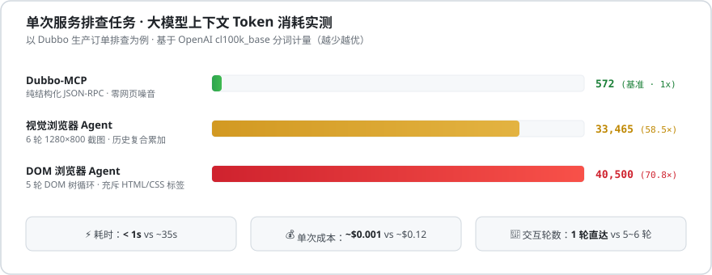

# dubbo-mcp

<p align="center">
  
  
  
  
  <a href="LICENSE"></a>
</p>

Dubbo-MCP 是连接 AI 编程助手（Codex、Cursor、Claude Code、ZCode 等）与 Dubbo 微服务的 [Model Context Protocol (MCP)](https://modelcontextprotocol.io/) 服务端。

在日常排查业务问题与联调时，让 AI 助手直接检索微服务接口、查看入参结构并发起接口调用，无需手动编写测试用例或引入业务工程依赖 Jar 包。

---

## 🚀 快速安装

### 1. 一键脚本安装

**macOS / Linux：**
```bash
curl -fsSL https://raw.githubusercontent.com/b1n9bna/dubbo-mcp/main/install.sh | sh
```

**Windows (PowerShell)：**
```powershell
irm https://raw.githubusercontent.com/b1n9bna/dubbo-mcp/main/install.ps1 | iex
```

脚本会下载可执行文件至 `~/.dubbo-mcp/dubbo-mcp.jar`，并创建全局命令 `dubbo-mcp`。

*(也可通过本地源码编译：`mvn clean package -DskipTests`)*

### 2. 自动注入 AI 助手配置

安装后执行以下命令，可自动检测本机已安装的 Codex、Cursor、Claude 等工具并写入配置：
```bash
dubbo-mcp install
```

---

## ⚙️ 环境配置

配置文件路径：`~/.dubbo-mcp/config.properties`

```properties
# 默认激活的环境 (test / uat / prod)
active.env=test

# ==============================================================================
# 1. 开发/测试环境 (直连 ZooKeeper，泛化调用)
# ==============================================================================
env.test.type=zookeeper
env.test.registry=zookeeper://127.0.0.1:2181
env.test.timeout=5000
env.test.readonly=false

# ==============================================================================
# 2. 预发环境 (UAT)
# ==============================================================================
env.uat.type=zookeeper
env.uat.registry=zookeeper://10.20.1.15:2181
env.uat.timeout=5000
env.uat.readonly=true

# ==============================================================================
# 3. 生产环境 (对接 dubbo-admin HTTP API)
# ==============================================================================
env.prod.type=dubbo-admin
env.prod.admin_url=https://dubbo.yourcompany.com
env.prod.readonly=true
env.prod.data_masking=true

# 只读校验正则：开启 readonly=true 时，仅允许匹配该正则的方法名被执行
security.readonly.regex=^(get|query|find|select|list|count|check|is|search|fetch|read).*$

# 自定义 dubbo-admin 上下文路径（可选，如 /dubbo-admin）
# env.prod.admin_api_prefix=/dubbo-admin
```

---

## 🔐 生产环境登录授权 (dubbo-admin)

企业内部的 Dubbo Admin 通常接入了单点登录（SSO/OAuth）。若配置了 `env.prod.type=dubbo-admin`，首次使用或会话过期后，需在终端执行一次凭据保存：

1. **获取登录态**：在浏览器打开并登录 Dubbo Admin 页面，按 <kbd>F12</kbd> 打开控制台 Console，执行：
   ```javascript
   copy(JSON.stringify({
     cookie: document.cookie,
     authorization: localStorage.getItem('token') || localStorage.getItem('Admin-Token')
   }))
   ```
2. **终端保存凭据**：在本地终端直接执行（macOS 下 `--clipboard` 会自动从系统剪贴板读取，避免终端长文本截断）：
   ```bash
   dubbo-mcp login --clipboard
   ```

凭据通过验证后将保存在 `~/.dubbo-mcp/session-prod.json`（权限 `0600`）。MCP 进程调用时会自动读取该文件，会话过期后重新执行上述命令即可，无需重启 AI 助手。

---

## 🔌 客户端接入配置

若未使用 `dubbo-mcp install` 自动注入，也可手动在对应工具的配置文件中添加：

### Codex
在 `~/.codex/config.toml` 中添加：
```toml
[mcp_servers.dubbo]
command = "dubbo-mcp"
args = []
```

### Cursor
在 `.cursor/mcp.json` 中添加：
```json
{
  "mcpServers": {
    "dubbo": {
      "command": "dubbo-mcp",
      "args": []
    }
  }
}
```

### Claude Code / ZCode
可通过 Git 仓库添加插件：
```bash
/plugin marketplace add https://github.com/b1n9bna/dubbo-mcp.git
```
或以 `stdio` 方式配置命令 `dubbo-mcp`。

---

## 💬 使用示例

配置完成后，可以在 AI 对话中直接用自然语言发起请求：

### 场景 1：排查业务问题
> **提问**：“生产环境查一下订单号 2026103001 的详情，分析为什么没发货？”  
> **AI 动作**：
> 1. 调用 `dubbo_invoke`（传入 `env="prod"`, `interfaceName="com.corp.OrderQueryService"`, `method="getOrderDetail"`）；
> 2. Dubbo-MCP 通过 dubbo-admin 接口代理发起查询，并自动脱敏手机号、身份证等敏感字段；
> 3. AI 根据返回结果分析：“订单当前状态为已支付（PAID），仓库物流单号为空，停留在配货状态（STOCKING）。”

### 场景 2：检索服务与接口定义
> **提问**：“测试环境有哪些与用户 (user) 相关的 Dubbo 服务？查看它们提供了哪些方法及参数结构。”  
> **AI 动作**：
> 1. 调用 `dubbo_list_services(keyword="user")` 获取匹配的接口列表；
> 2. 调用 `dubbo_get_service_detail` 反查接口下的方法签名及 DTO 入参字段；
> 3. 整理列出服务的方法结构供后续调用。

### 场景 3：多环境动态切换
> **提问**：“把当前环境切到 UAT 环境。”  
> **AI 动作**：
> 调用 `dubbo_switch_env(env="uat")`，后续请求无缝切换至预发集群。

---

## 🛠️ MCP 工具列表

| 工具名 | 参数 | 说明 |
| :--- | :--- | :--- |
| `dubbo_list_services` | `keyword` (可选) | 按关键字搜索注册中心上的 Dubbo 服务接口 |
| `dubbo_get_service_detail` | `service` | 获取接口的方法列表、参数类型、DTO 字段属性及版本/分组信息 |
| `dubbo_invoke` | `service`, `method`, `args`, `env` (可选), `version` (可选), `group` (可选) | 发起接口调用，传入 JSON 入参，返回服务端的执行结果 |
| `dubbo_list_envs` | 无 | 查看已配置的环境列表及当前激活的环境 |
| `dubbo_switch_env` | `env` | 切换当前默认环境（如 `test` / `uat` / `prod`） |

---

## 🛡️ 安全控制

为防止误操作影响线上稳定性，针对生产环境提供了两项保护机制：
1. **只读方法校验**：在开启 `readonly=true` 的环境中，仅允许执行匹配 `security.readonly.regex` 正则的方法（如 `get*`、`query*`、`find*` 等只读前缀），写操作（如 `update*`、`delete*`）会被直接拦截；
2. **敏感数据脱敏**：开启 `data_masking=true` 后，自动对返回值中的手机号（`138****5678`）和 18 位身份证（`110101********2345`）进行掩码脱敏，防止敏感数据进入对话上下文。

---

## 🏗️ 架构与工作原理

```
 ┌────────────────────────────────────────────────────────┐
 │   AI 编程助手 (Codex / Cursor / Claude Code / ZCode)    │
 └───────────────────────────┬────────────────────────────┘
                             │
               STDIO 标准输入输出 (JSON-RPC 2.0)
                             │
 ┌───────────────────────────▼────────────────────────────┐
 │  1. Transport 层: StdioJsonRpcServer (纯 Java 8 实现)   │
 │     - 日志严格重定向至 stderr，保证 stdout 纯净用于通信    │
 ├────────────────────────────────────────────────────────┤
 │  2. 安全过滤与两阶段调度层                              │
 │     - 按需探测：搜索服务 -> 获取参数元数据 -> 发起调用     │
 │     - 生产环境安全保护：只读正则校验 + 敏感信息脱敏        │
 ├────────────────────────────────────────────────────────┤
 │  3. 双通道核心驱动 (Dual-Engine Driver)                 │
 │     - 测试/开发环境：直连 ZooKeeper，原生 RPC 泛化调用     │
 │     - 生产环境：通过 dubbo-admin HTTP 接口中转调用         │
 └───────────────────────────┬────────────────────────────┘
              ┌──────────────┴──────────────┐
              ▼                             ▼
   [开发/测试环境: ZooKeeper]        [生产环境: HTTP 中转]
     Dubbo Provider 节点           企业已部署的 Dubbo Admin
```

---

## 📊 性能与 Token 消耗实测

<p align="center">
  
</p>

> **实测结果**：在单次微服务接口排查任务中，Dubbo-MCP 的结构化调用相比传统浏览器 Agent 方案 **节省约 98% 上下文 Token**，**响应提速 30 倍以上**，且无网页 DOM 噪音与多轮截图历史累加的包袱。

### 1. 大模型交互开销对比（单次服务排查）

| 方案 | 交互方式 | 交互轮数 | 上下文总 Token (实测) | 耗时 | 确定性 / 稳定性 | 单次估算成本 |
| :--- | :--- | :--- | :--- | :--- | :--- | :--- |
| **Dubbo-MCP** | 纯结构化 JSON-RPC | **1 轮直达** | **572** | **< 1s** | **100%** (纯接口) | **~$0.001** (0.7分钱) |
| **DOM 浏览器 Agent**<br>*(Playwright / Browser-Use)* | 页面 DOM 树状态机循环 | 5 轮循环 | **40,500** *(70.8×)* | ~28s | 易受网络慢/遮罩层阻断 | ~$0.12 (8毛钱) |
| **视觉浏览器 Agent**<br>*(Computer Use / 截图)* | 1280×800 界面截图切片 | 6 轮截图 | **33,465** *(58.5×)* | ~35s | 存在图像识别误触概率 | ~$0.10 (7毛钱) |

<details>
<summary><b>点击查看测试方法与 Token 计量推导 (Methodology)</b></summary>

- **分词计量基准**：统一采用 OpenAI `cl100k_base` BPE 分词器编码，以真实生产订单详情排查为基准场景；
- **Dubbo-MCP 实测**：`tools/list` 基础 Schema（397 Token）+ 单次请求入参（51 Token）+ 接口返回真实数据（90 Token）+ AI 总结回答（34 Token）= **572 Token**；
- **视觉浏览器 Agent**：Anthropic 官方视觉公式（1280×800 截图每张约 1,365 Token），在 Dubbo Admin 完成“搜索 -> 点击 -> 填参 -> 提交 -> 查看弹窗”共 6 轮截图，按多轮对话上下文历史复合累加（$O(N^2)$）计算；
- **DOM 浏览器 Agent**：以 Dubbo Admin（Vue + Element UI）渲染后的页面可访问性树（单步约 2,500 Token），5 轮状态机历史复合累加计算。
</details>

### 2. 本地进程资源占用

| 指标 | 实测数值 | 说明 |
| :--- | :--- | :--- |
| **冷启动耗时** | **< 100 ms** | 进程轻量，随起随用 |
| **常驻内存 (RSS)** | **~25 MB** | 内存开销小，长时间运行无负担 |
| **标准流隔离** | **严格分离** | 日志重定向至 `stderr`，确保 `stdout` 仅用于 JSON-RPC 通信 |
| **运行依赖** | **仅需 JRE 8+** | 单个 Fat-JAR 运行，内置 Dubbo 泛化调用与 Curator |

---

## ❓ 常见问题

<details>
<summary><b>1. 复杂的 Java DTO 入参（嵌套对象、枚举）怎么传？</b></summary>

Dubbo-MCP 基于 Dubbo 原生泛化调用（Generic Invocation）：
* **字段结构感知**：调用 `dubbo_get_service_detail` 时，会从 ZooKeeper 元数据中心反查入参 DTO 的属性结构（如 `current`, `size`, `calculationDateList` 等）；
* **类型自动匹配**：AI 在 `dubbo_invoke` 的 `args` 中直接传入对应的 JSON Map 即可，底层会自动匹配目标 DTO 类型并完成序列化转换。
</details>

<details>
<summary><b>2. 多版本（version）或多分组（group）如何路由？</b></summary>

* 底层会自动从注册中心读取 Provider 列表，若该接口仅注册了单一版本或单一分组，会自动选用；
* 若存在多个不同版本或分组，可在 `dubbo_invoke` 中显式指定 `version` 或 `group` 参数进行精准路由。
</details>

<details>
<summary><b>3. 生产环境登录态过期后如何处理？</b></summary>

若企业 SSO 会话过期，接口调用会返回 401/403。此时只需在浏览器重新打开 Dubbo Admin 执行复制脚本，在终端重新执行 `dubbo-mcp login --clipboard` 即可。运行中的 MCP 进程会在下一次请求时自动热加载新凭据，无需重启 AI 助手。
</details>

---

## 💻 本地构建与测试

```bash
# 运行单元测试
LANG=en_US.UTF-8 LC_ALL=en_US.UTF-8 mvn test

# 打包可执行 Fat-JAR
LANG=en_US.UTF-8 LC_ALL=en_US.UTF-8 mvn package -DskipTests
```
